- measure importance of different variables
- 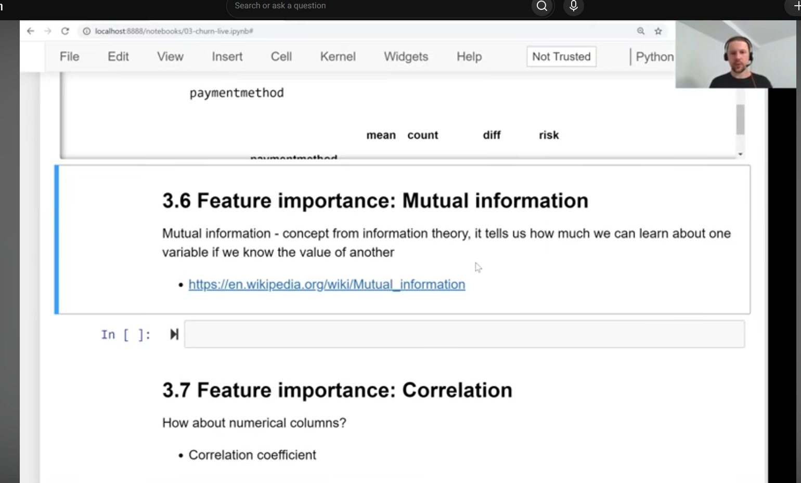
- 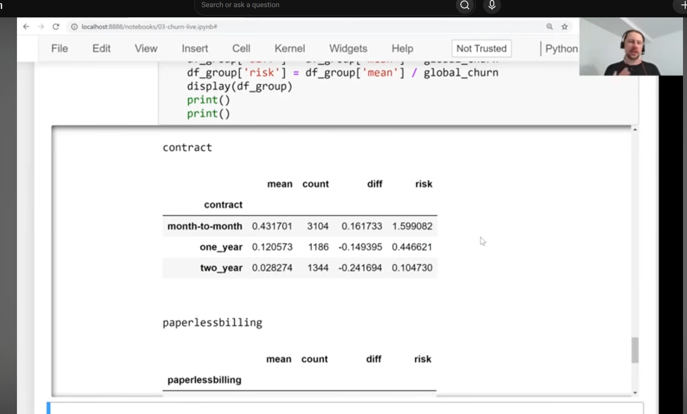
- 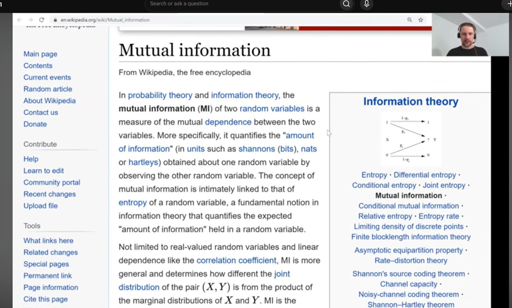
- how much do we learn about churn if the observe value of contract?
- 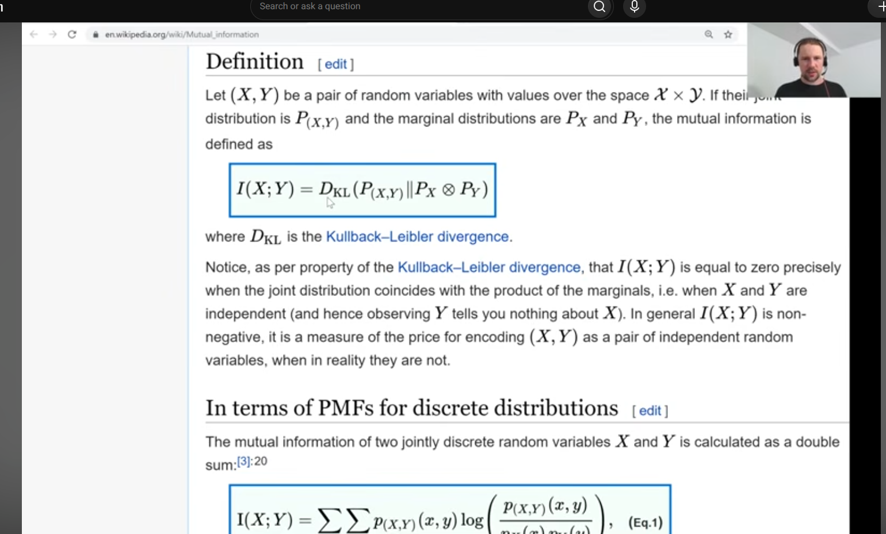
- 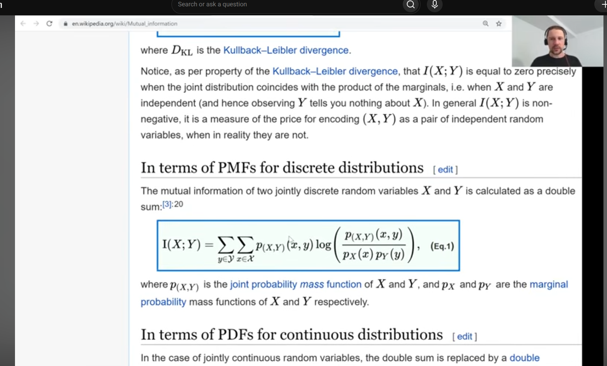
- sklearn
- 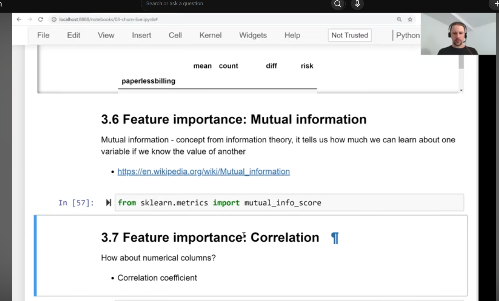
- 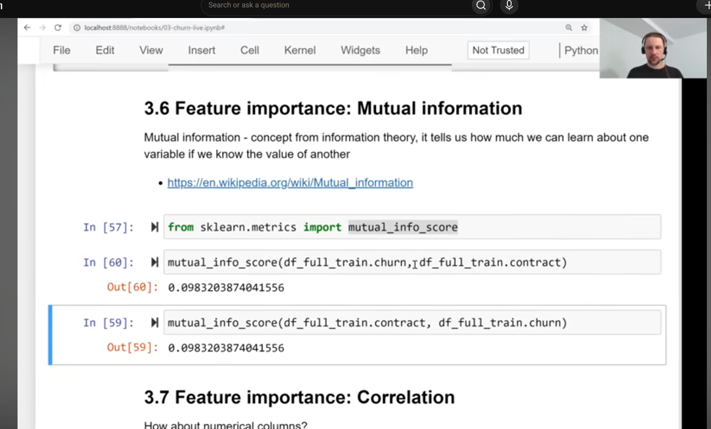 
- 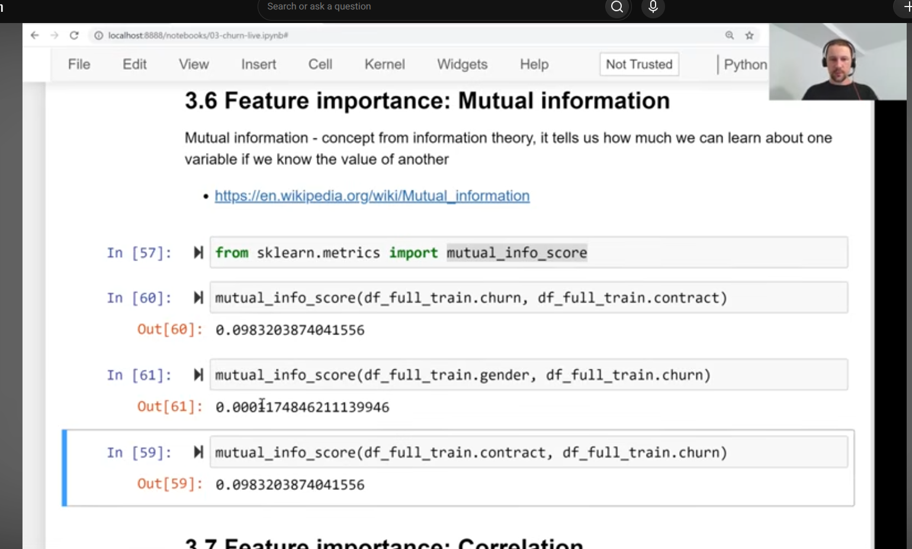
- gender - no relationship with churn
- contract more important than gender for churn
- 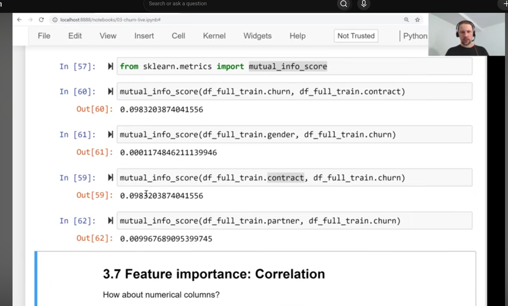
- partner more important than gender, but less so for contract
- hard to interpret, but we can know one is more important than the other
- 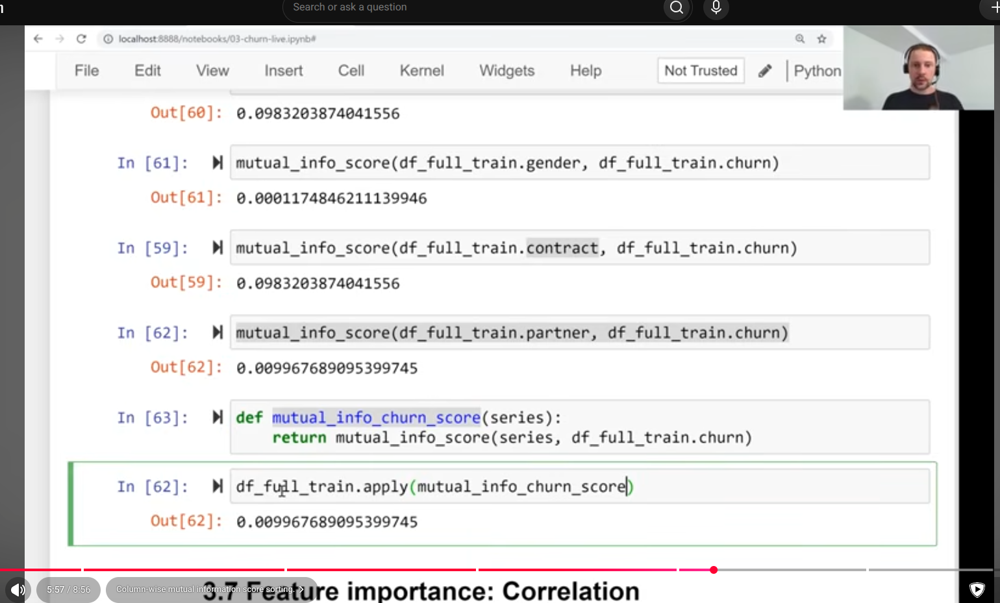
- apply takes a function with one argument and applies to each column
- 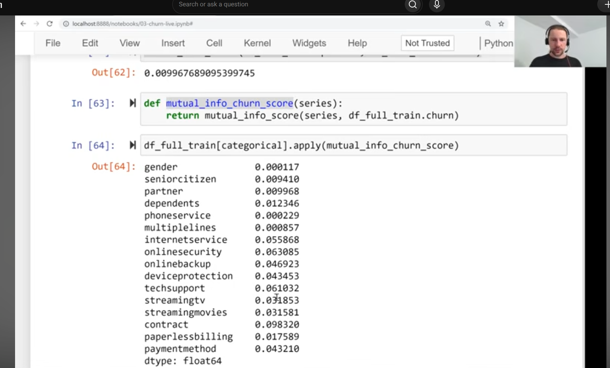
- 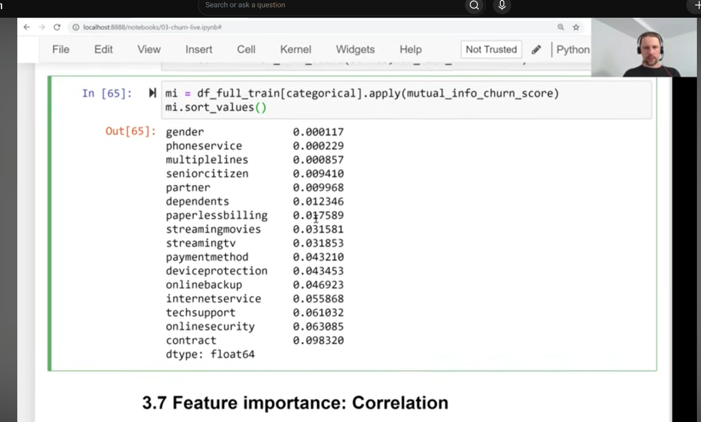
- 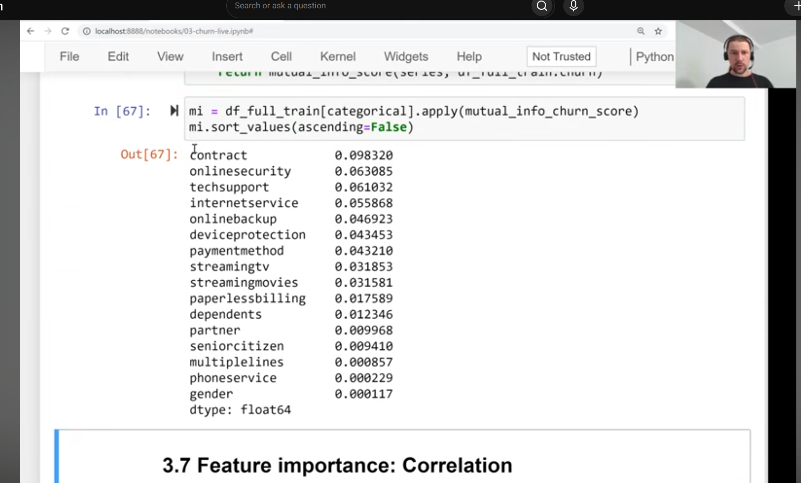
- contract is most important and gender is the least
- 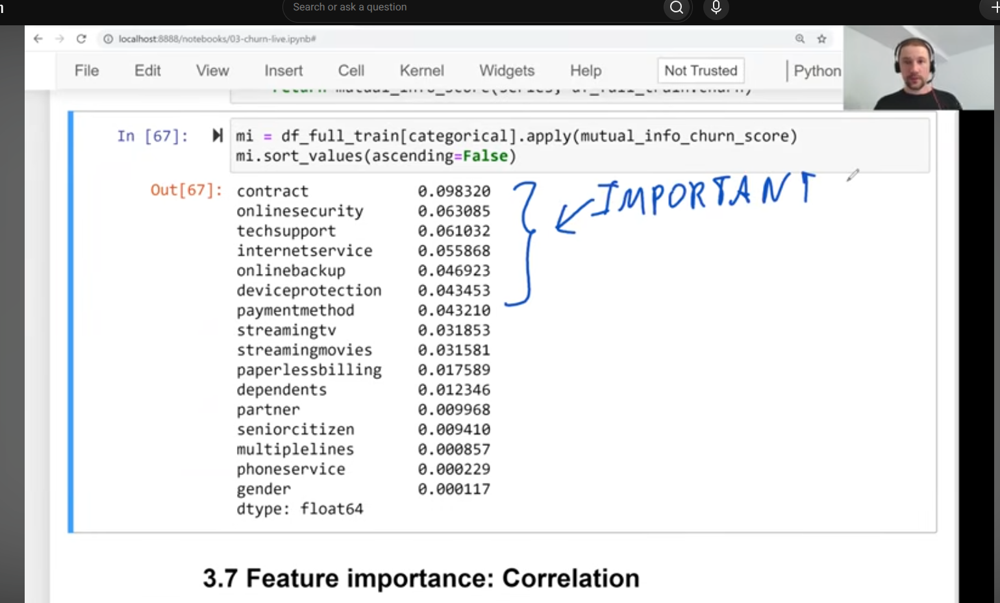
- 