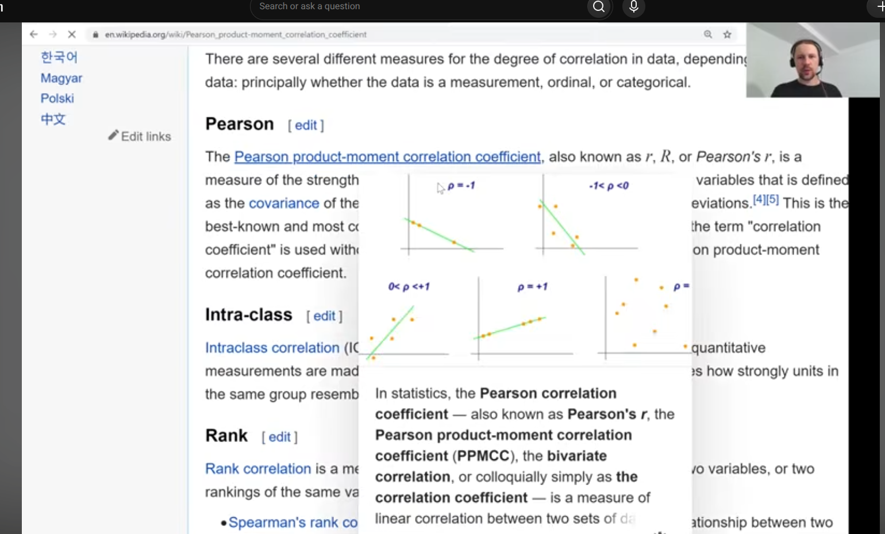
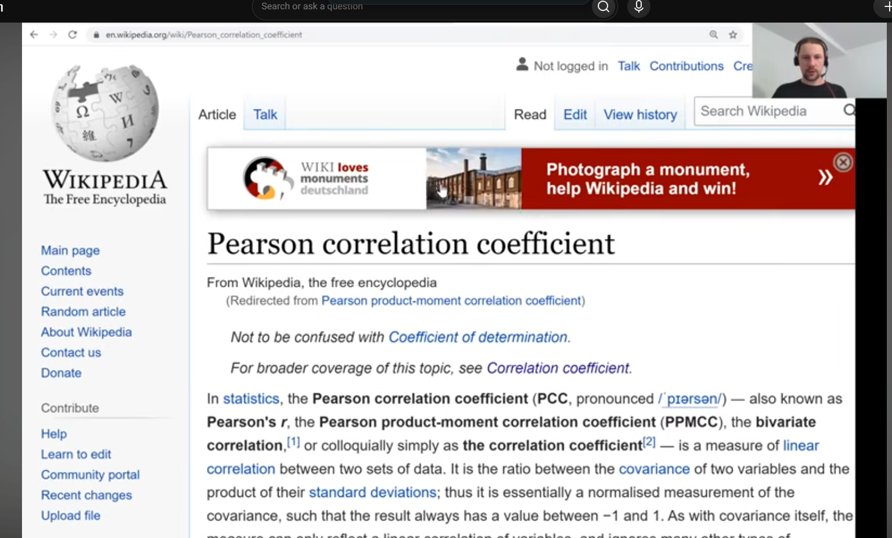
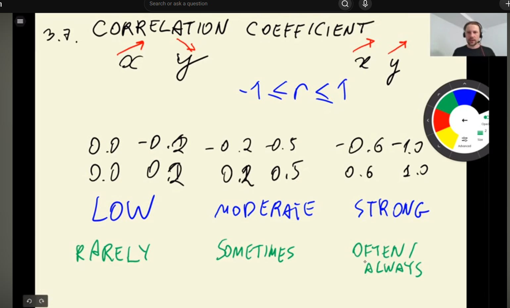
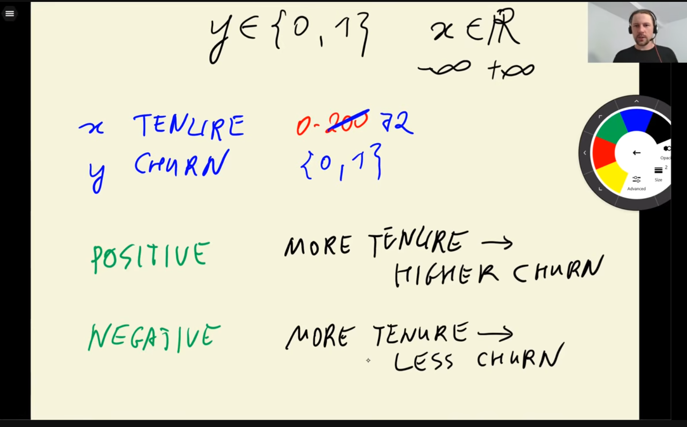
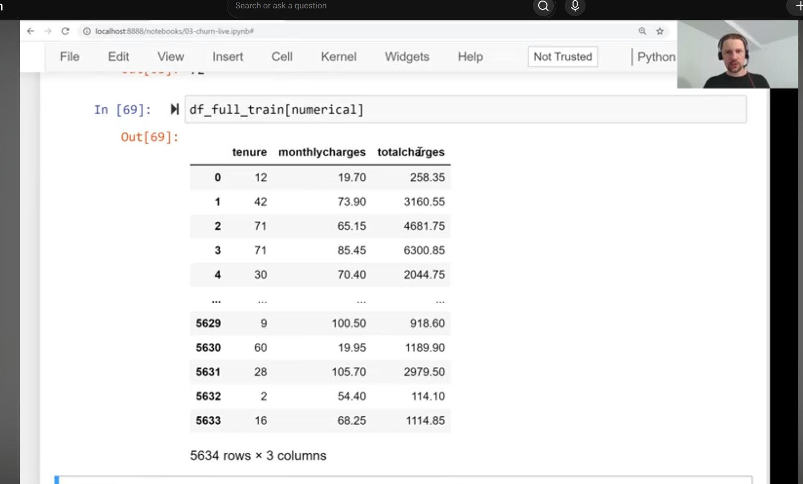
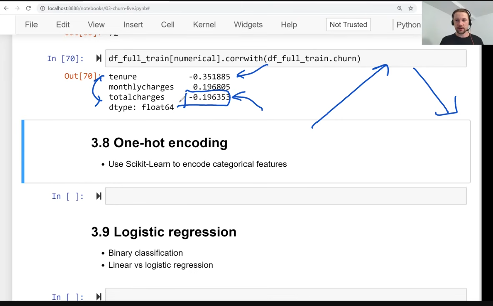
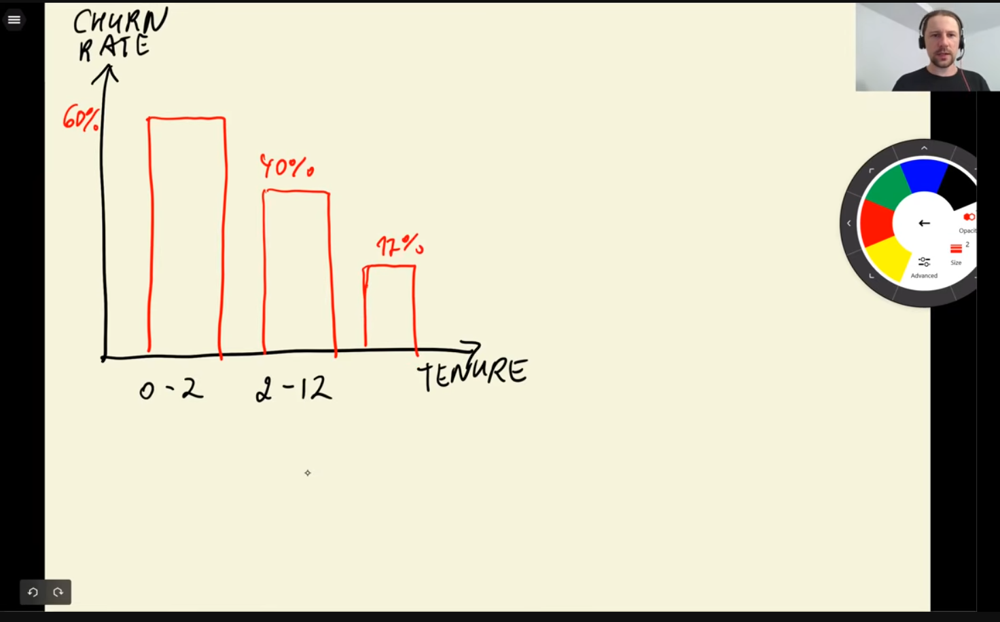
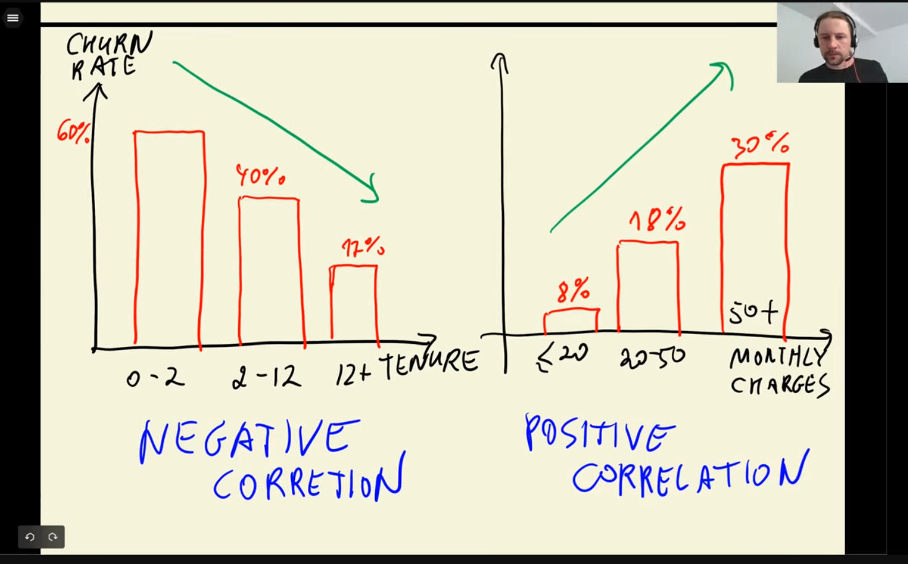
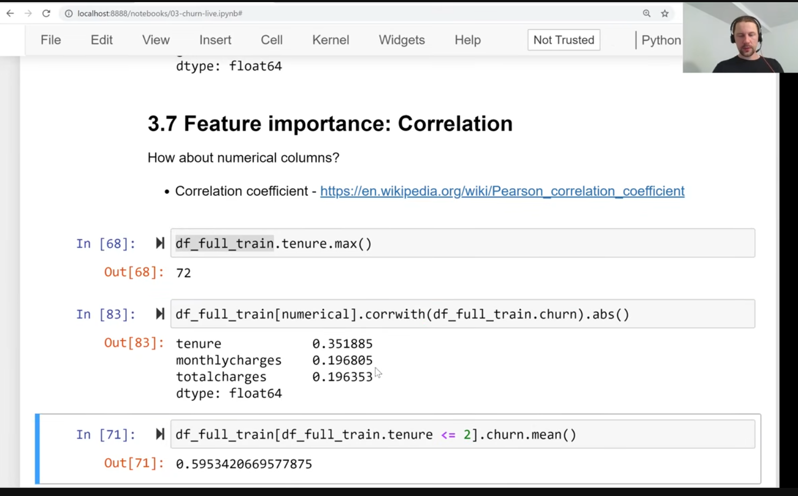

- pearson's correlation
- 
- 
- 
- measure dependency between two variables
- 
- for real numbers
- but for binary variables...
- 
- 
- 
- longer customer stays, the less they will churn
- 
- high monthly charges, more likely they will leave
- 
- 
- 
- churn rate increases with cost of monthly charges
- 
-  
- if only care about importance and not correlation