- trained 2 models (model with all features and model with a limited number of features)
- 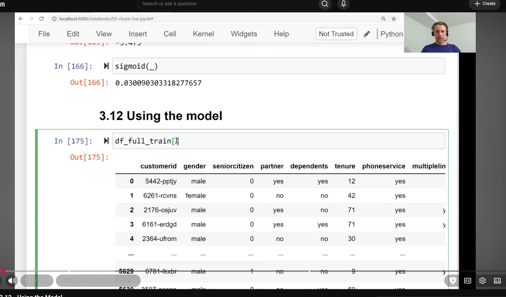
- 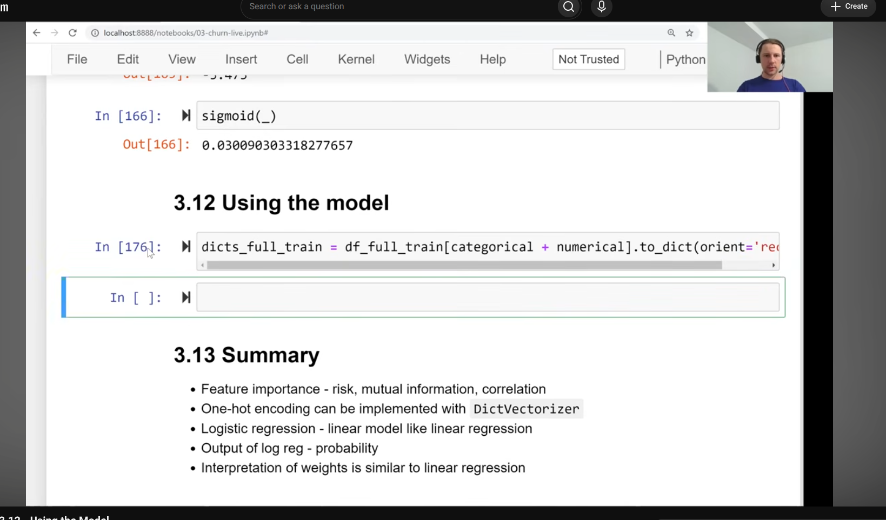
- 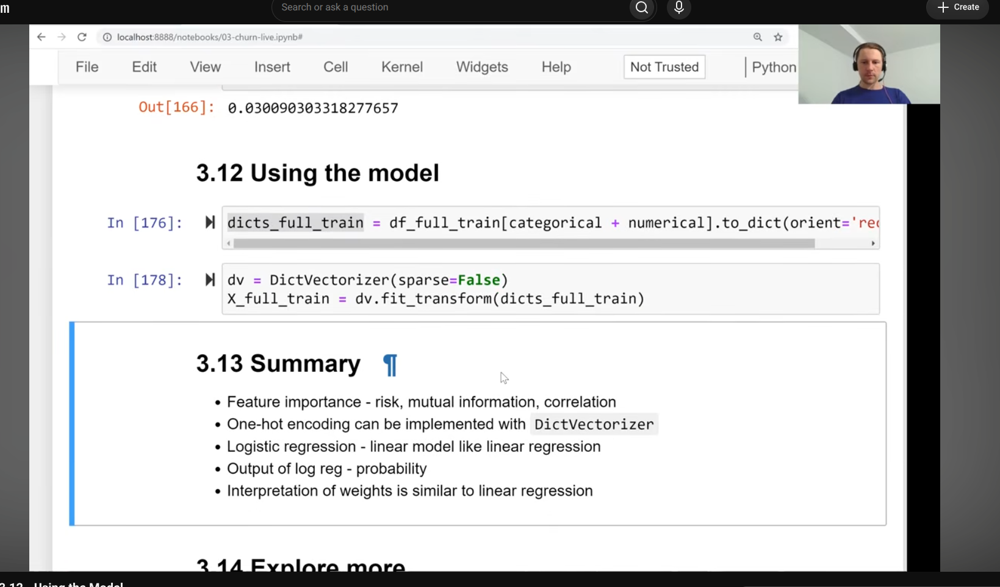
- 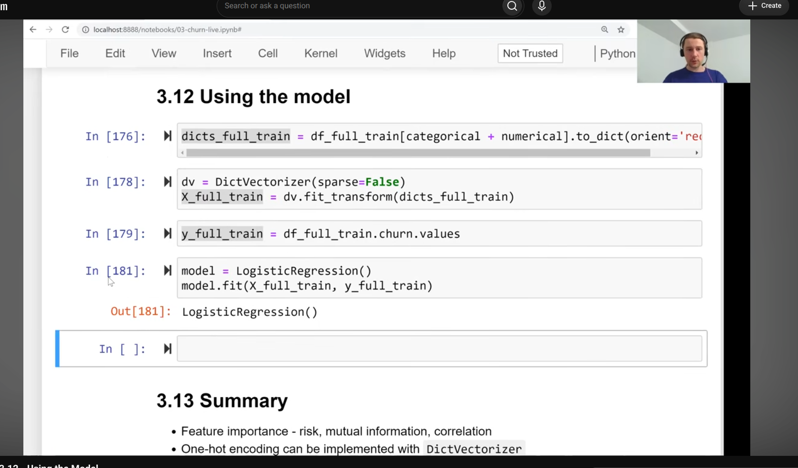
- now we have model
- 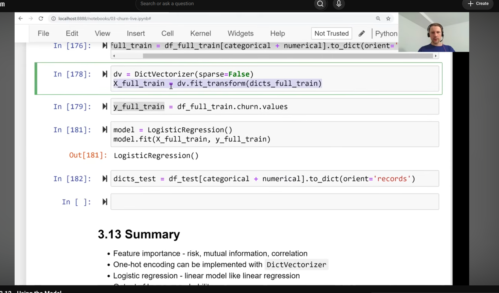
- 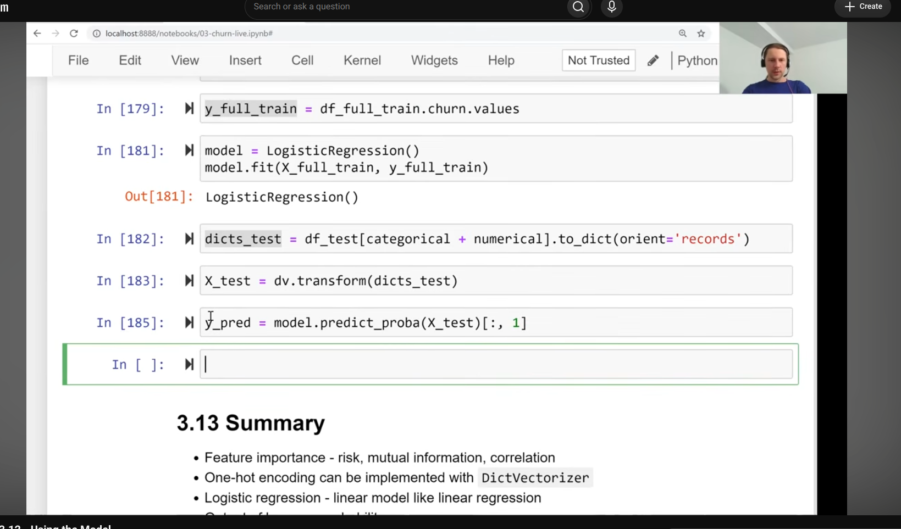
- 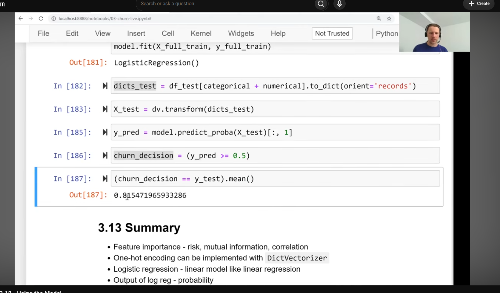
- 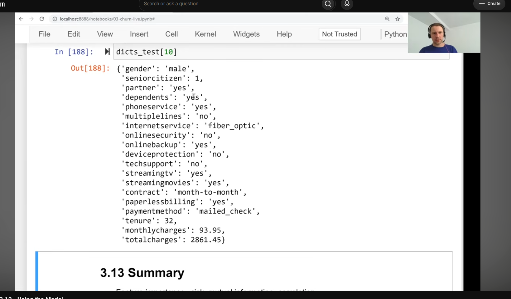
- taking customer from dataset
- 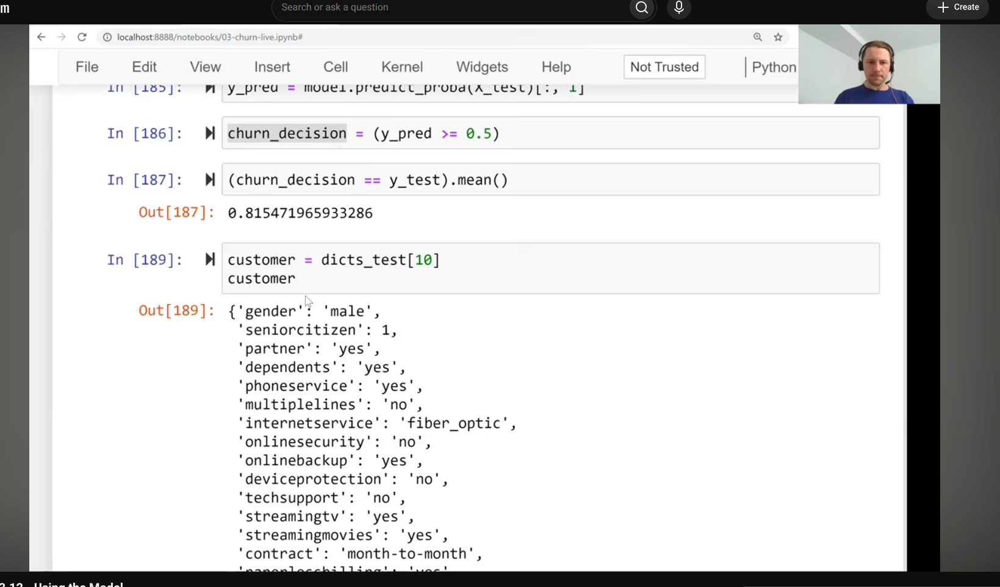
- 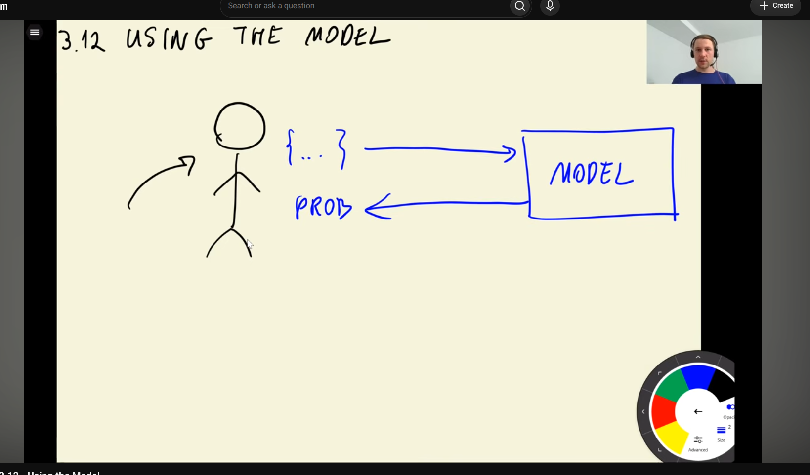
- customer is already a dictionary
- 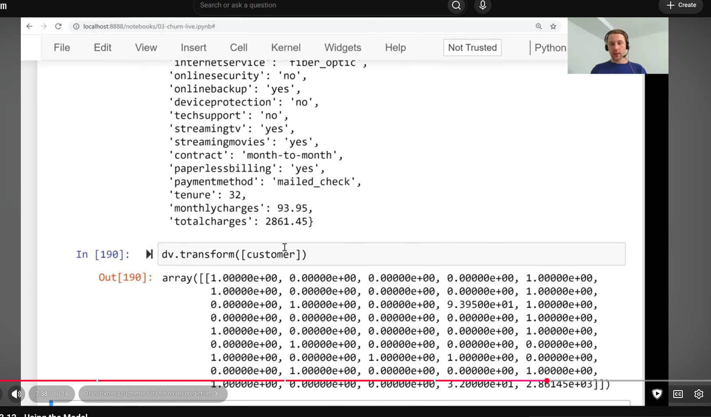
- 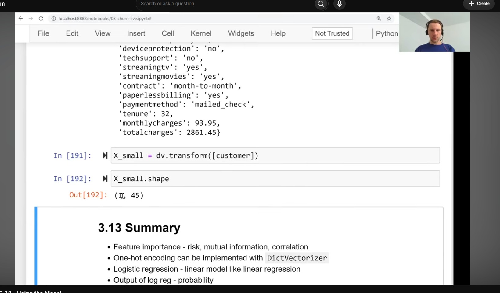
- 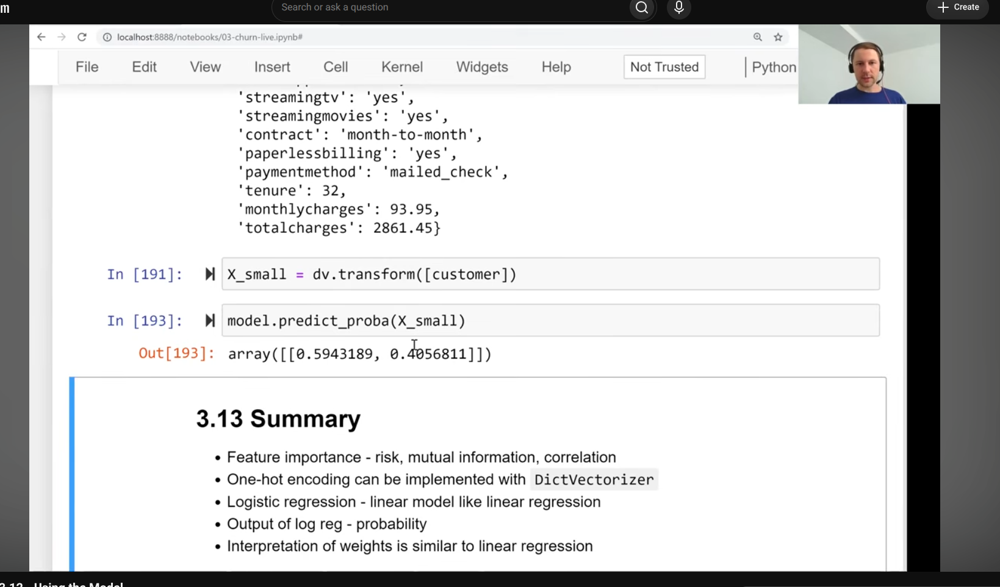
- 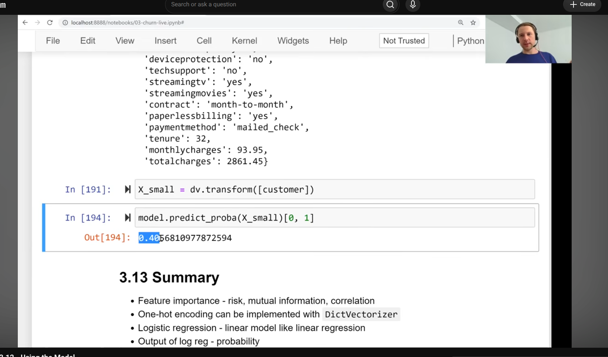
- customer has 40% probability of churning
- 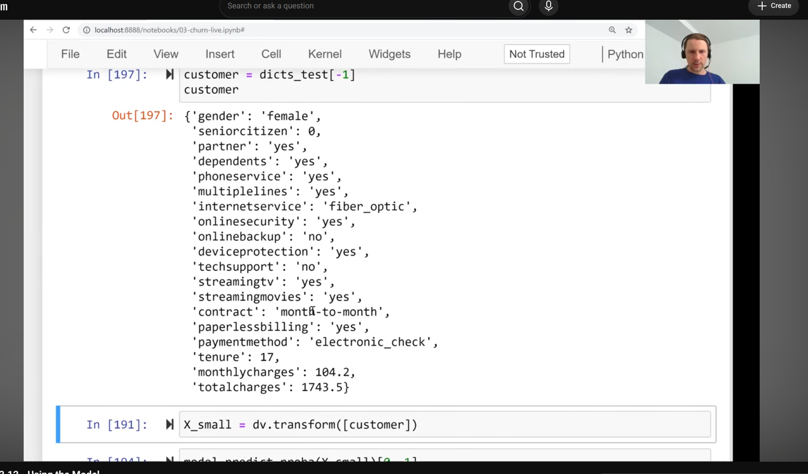
- in this case for the last customer, we think she will churn
- 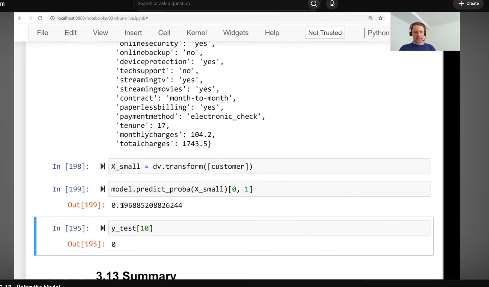
- 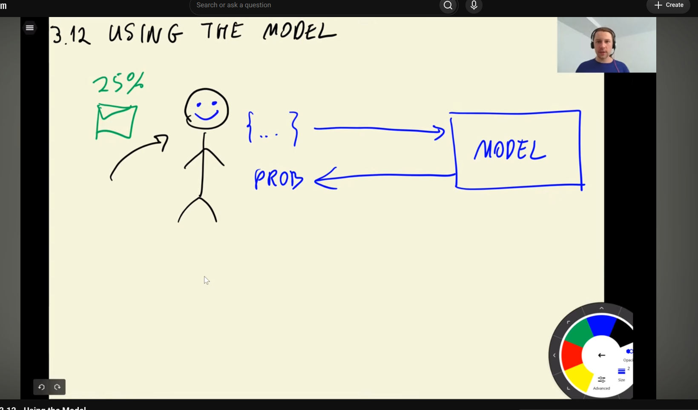
- 