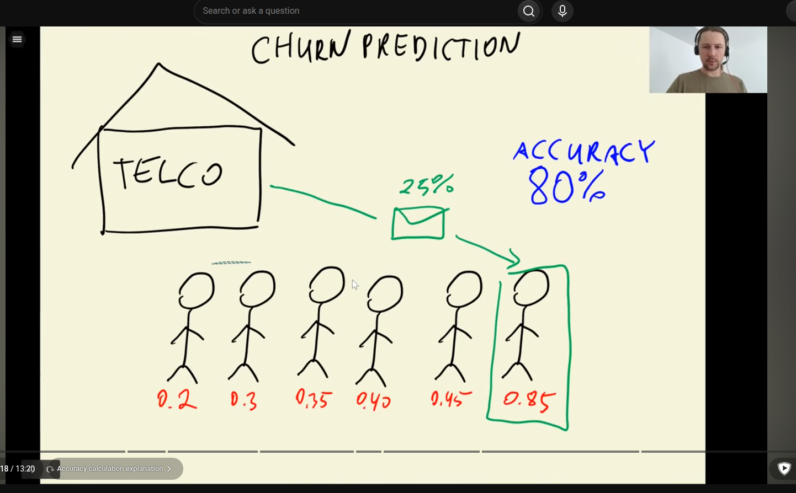 
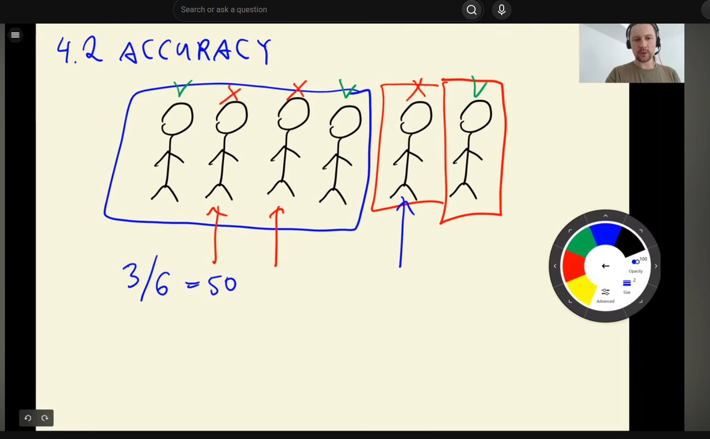 
- accuracy tells us about fraction of correct predictions
- 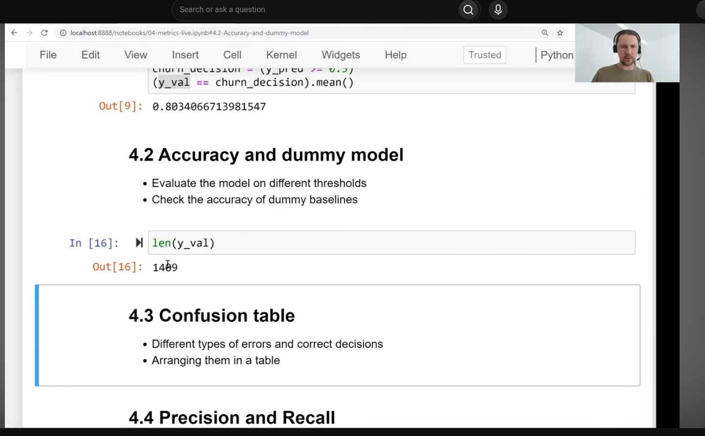
- number of customers: 1409 customers
- 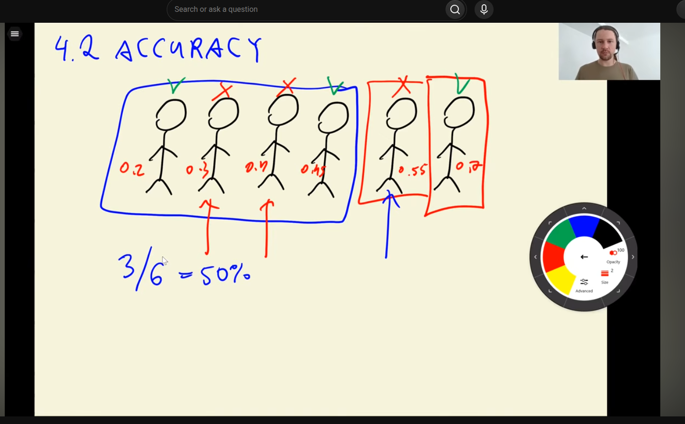
- 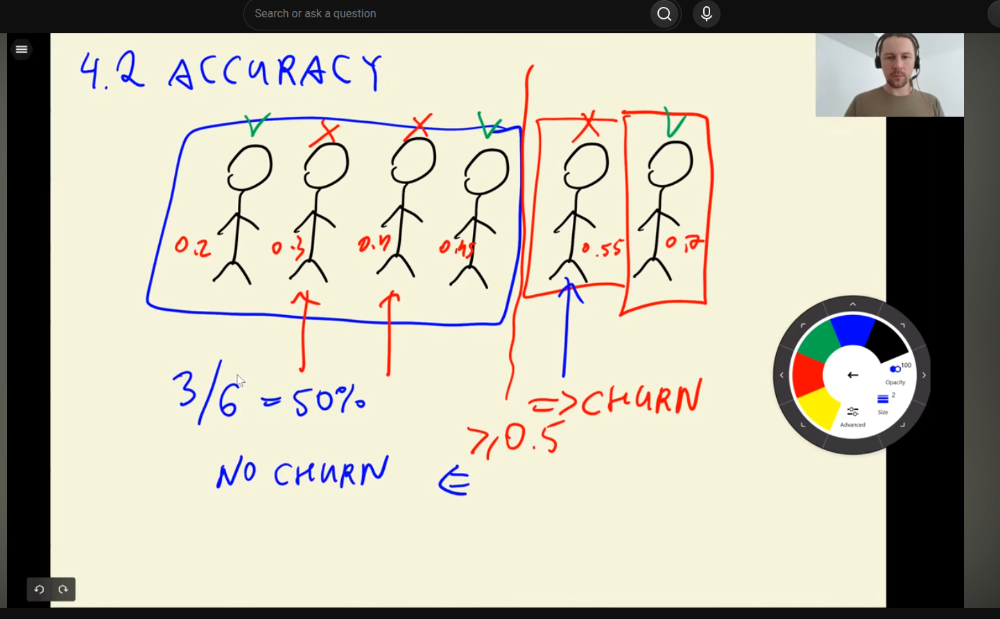
- 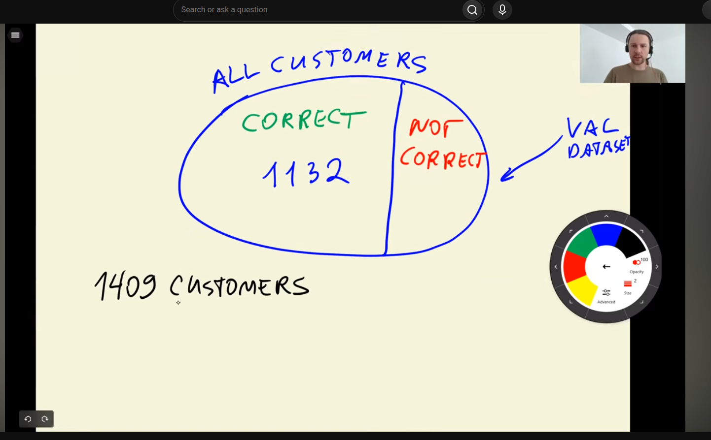
- 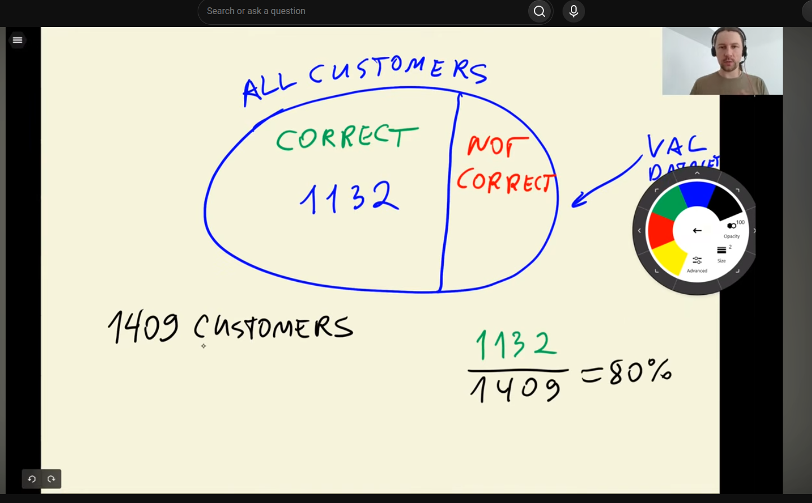
- 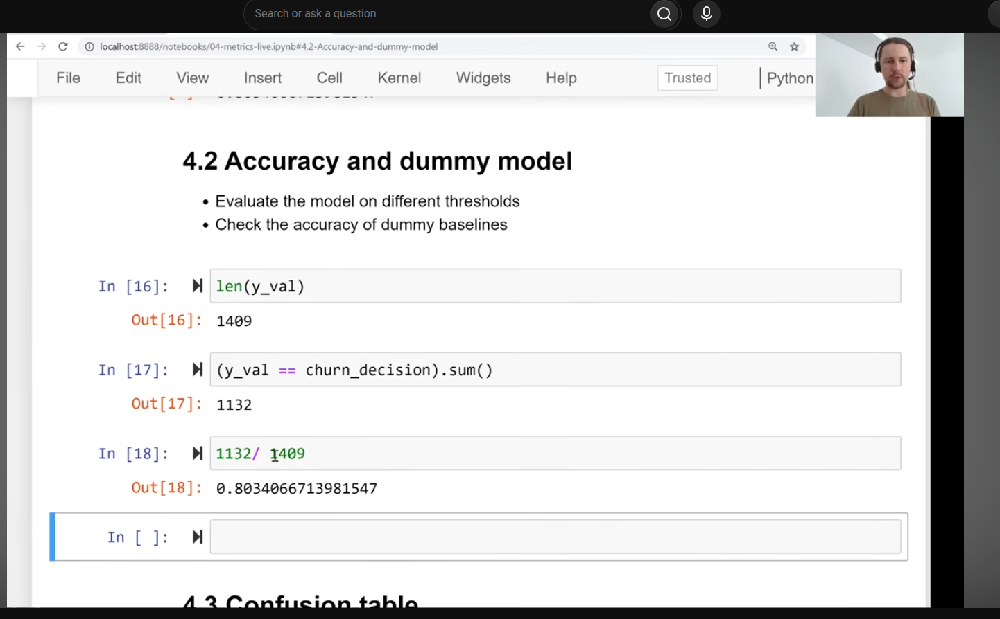
- 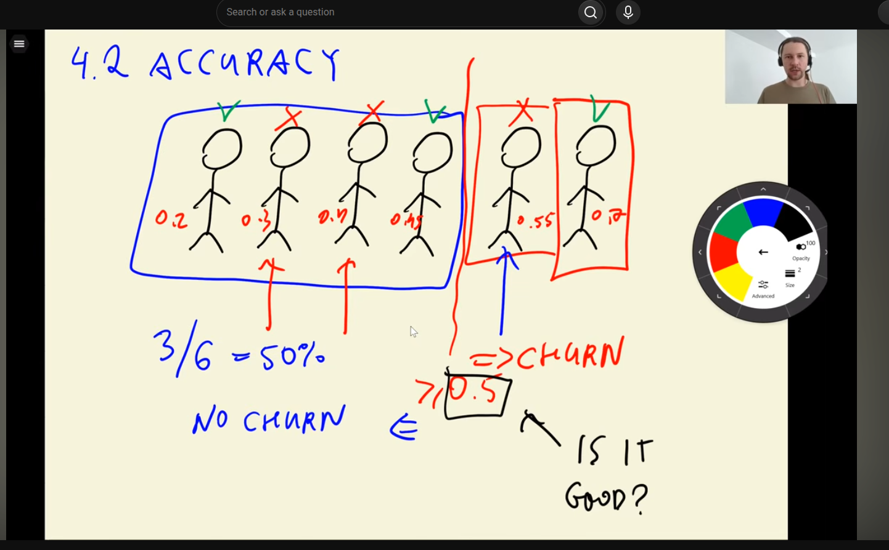
- 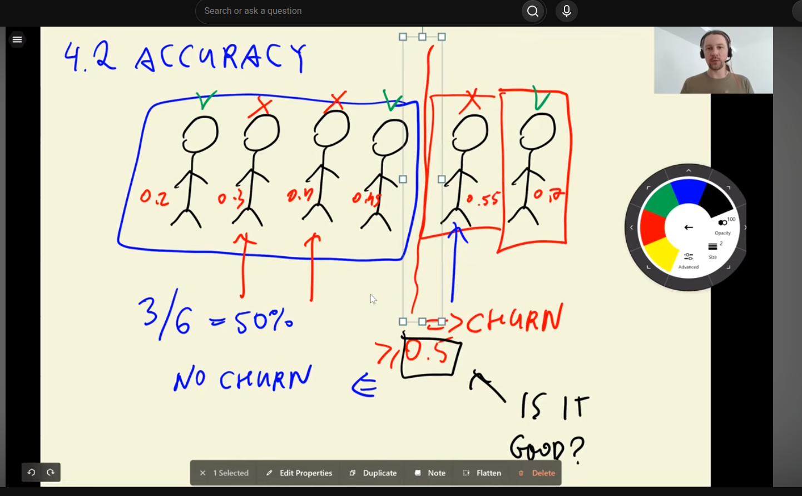
- instead of 0.5, we can move to 0.3, or 0.6
  - to improve accuracy or not
- takes first and last value of array
- each is threshold
- 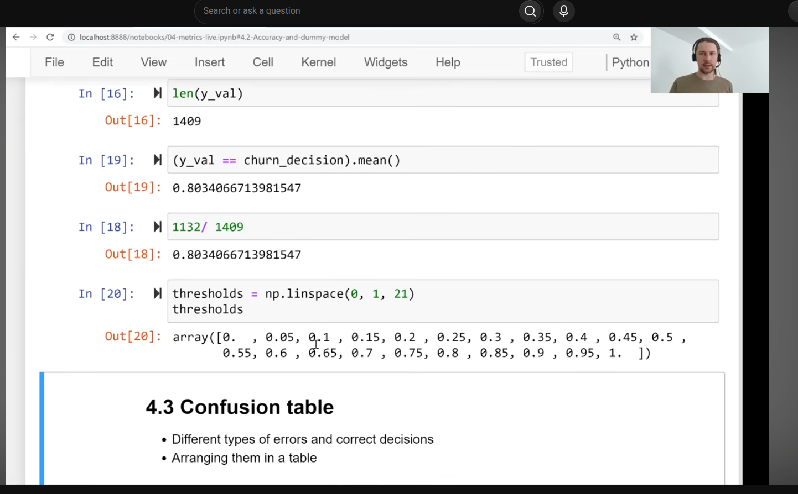
- 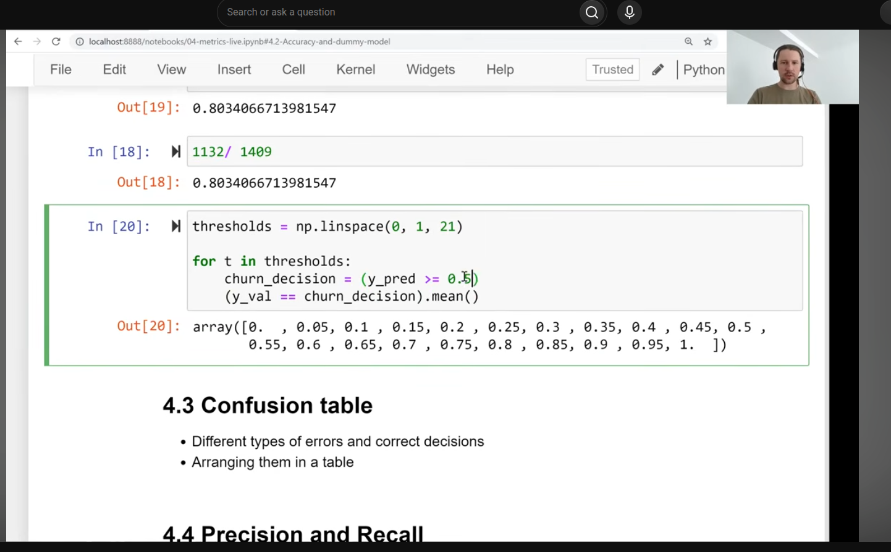
- 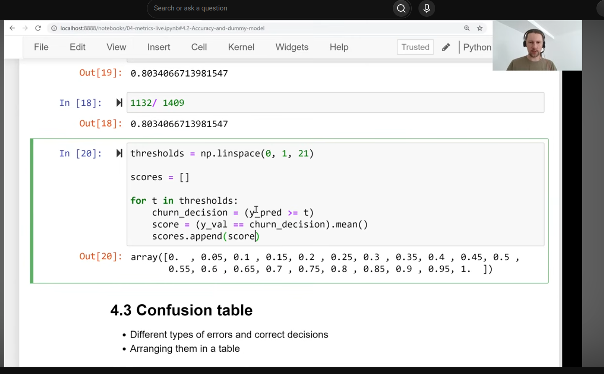
- 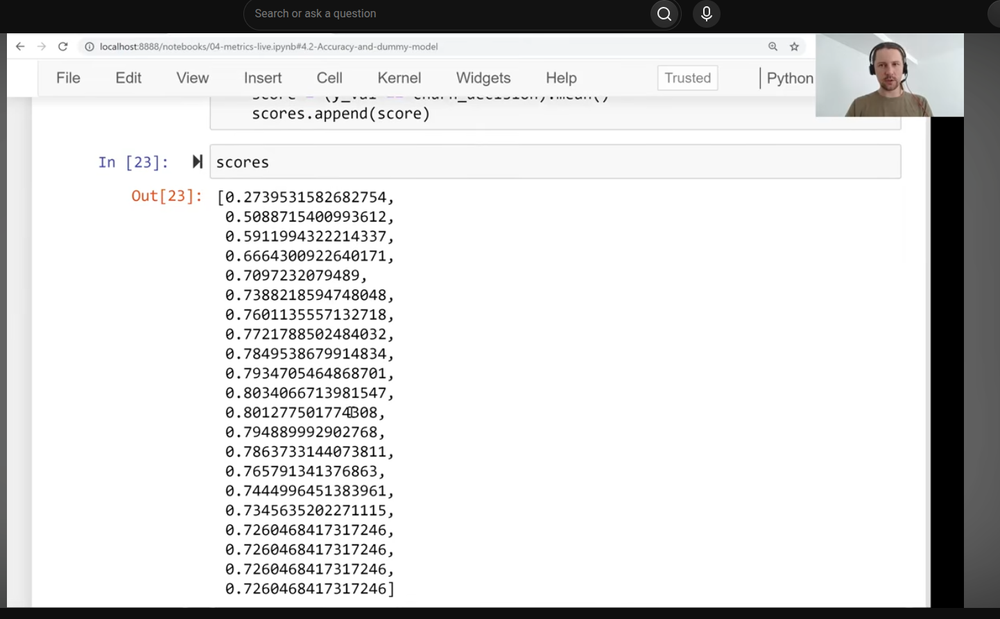 