`https://www.youtube.com/watch?v=Jt2dDLSlBng&list=PL3MmuxUbc_hIhxl5Ji8t4O6lPAOpHaCLR&index=44

- way of looking at errors and correct decisions that binary classifcation model makes
- quality of model not effected by class imbalance
- 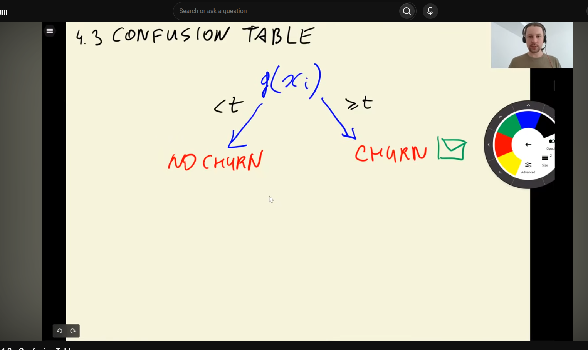 
-  
- type i and ii errors
- 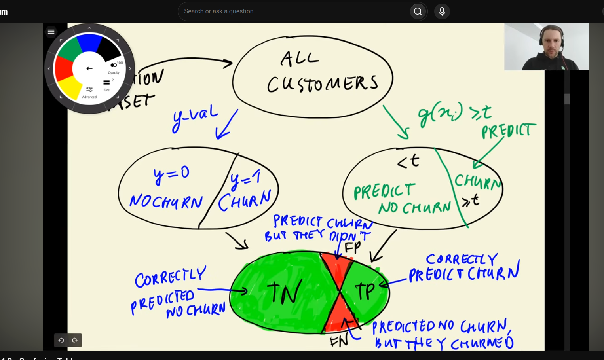
- 
- 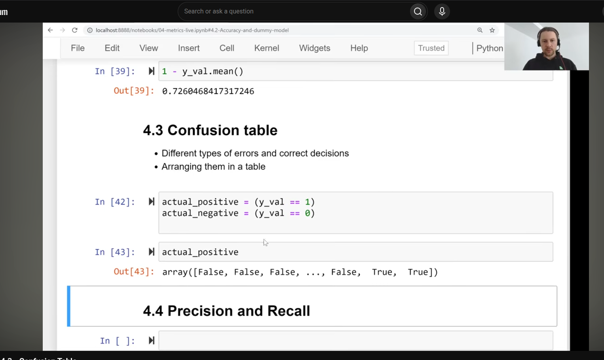
- 
- 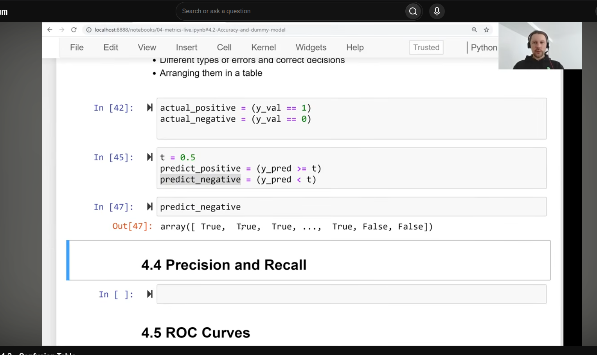
- 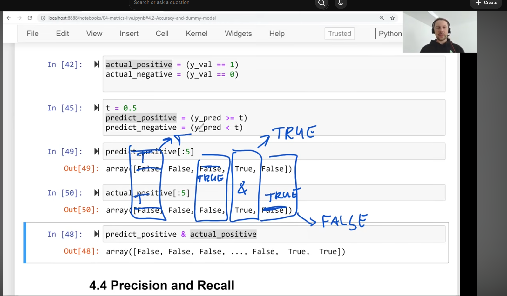
- 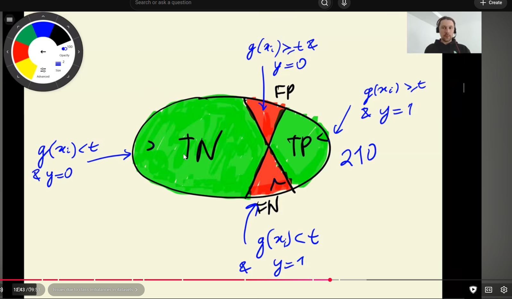
- 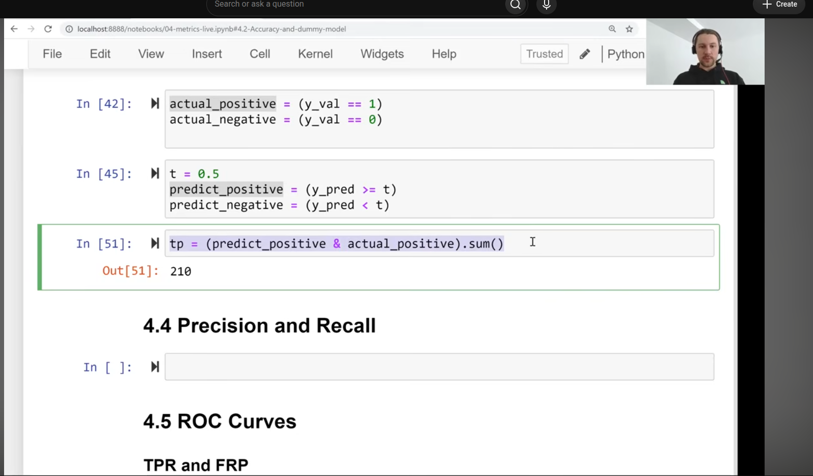
- 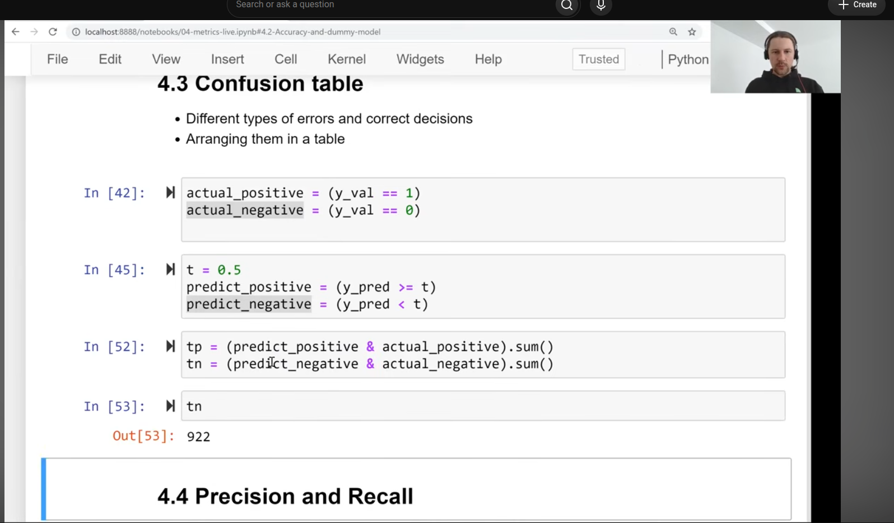
- 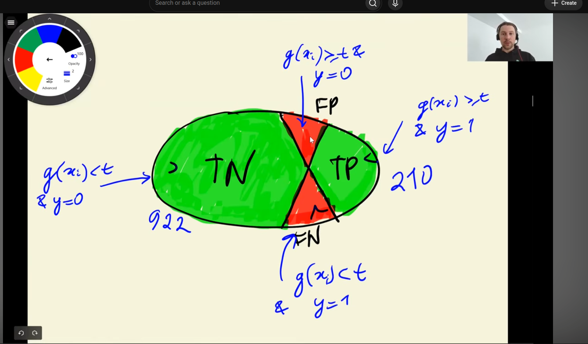
- 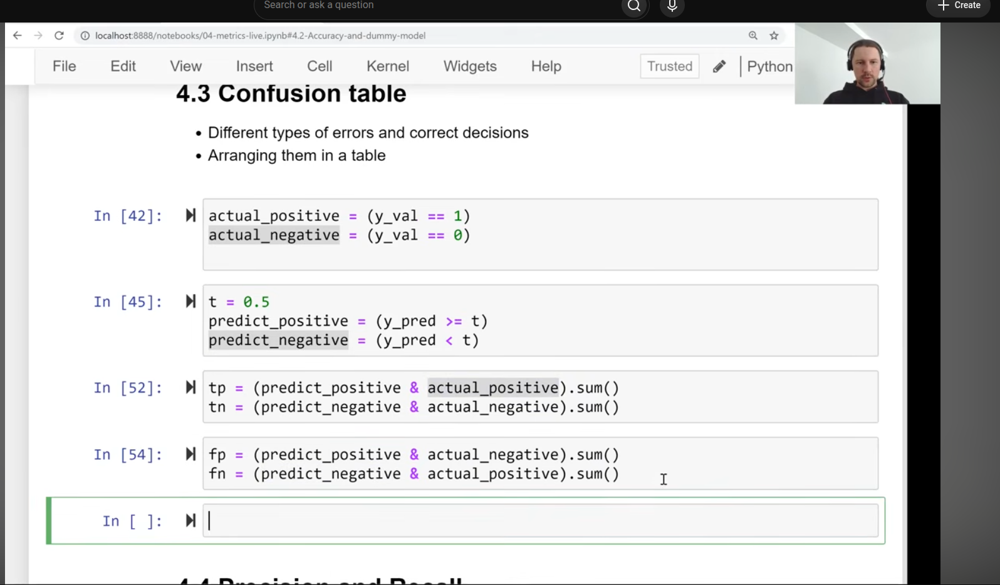
- 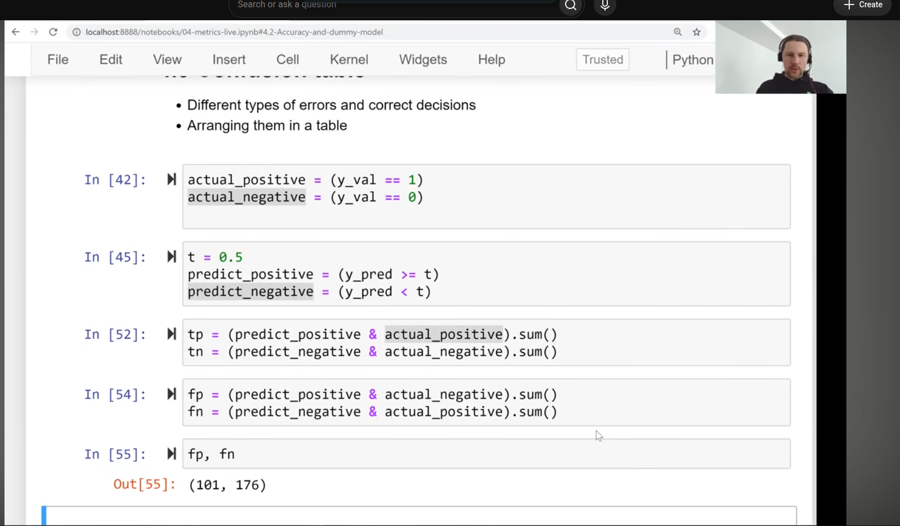
- 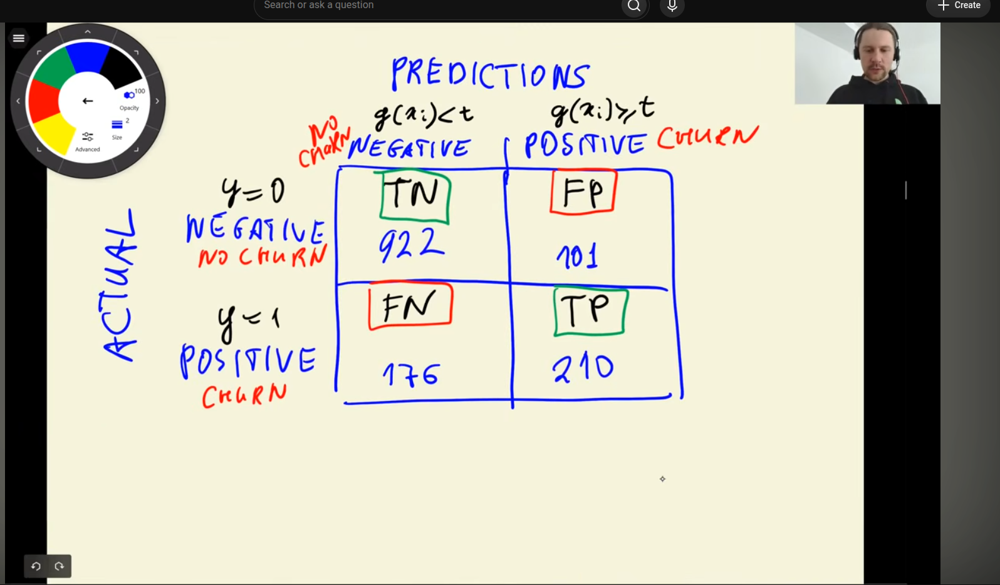
- confusion matrix
- 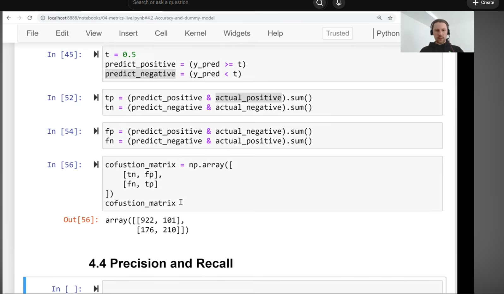
- 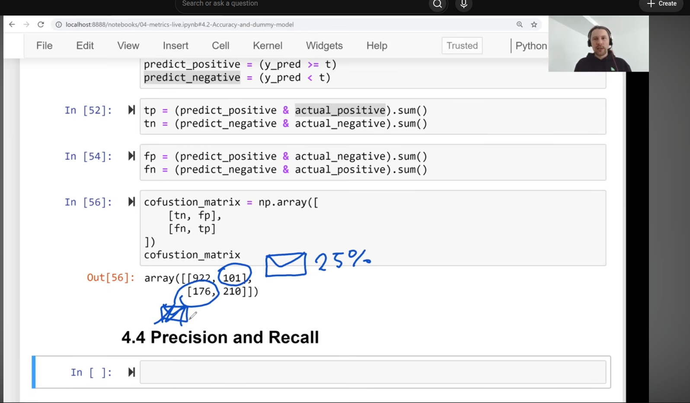
- false positives and negatives are monetary loss
  - false positives more difficult to catch
- 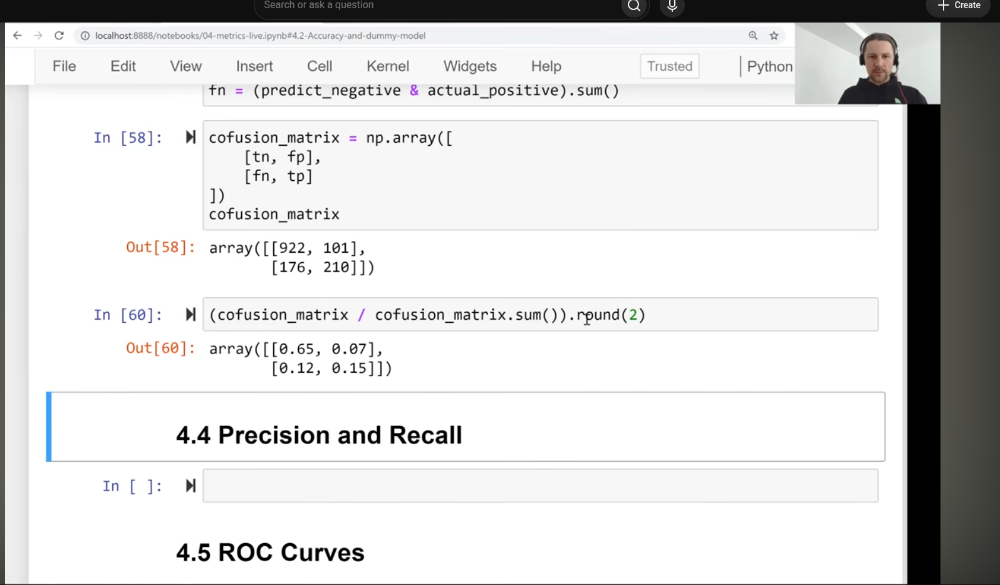
- 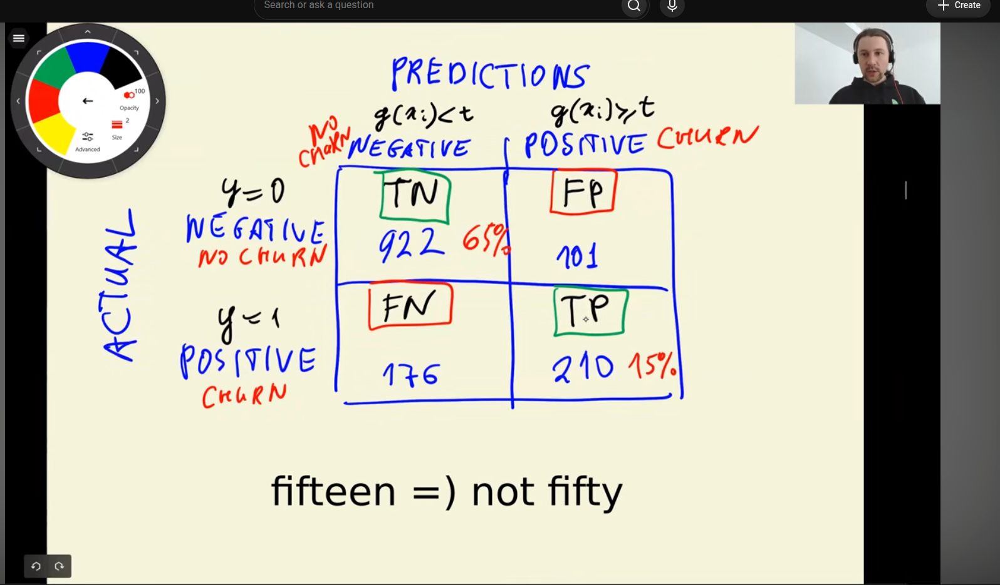
- 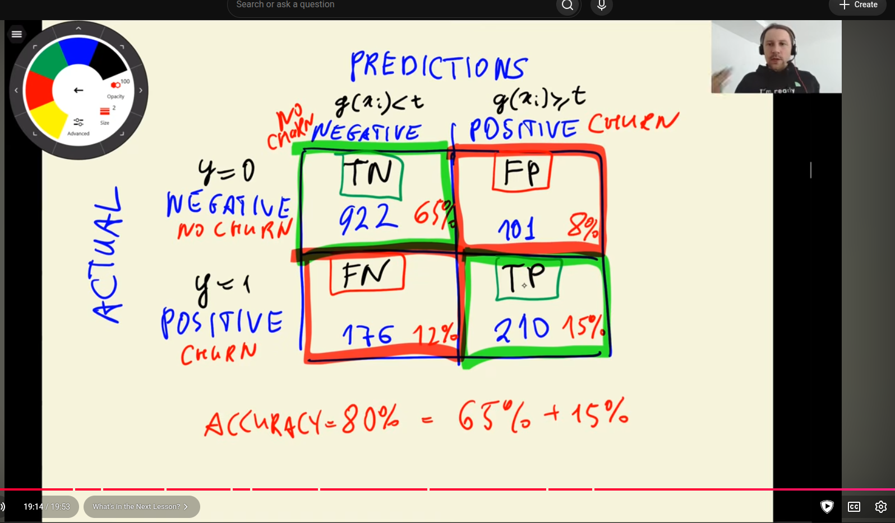 